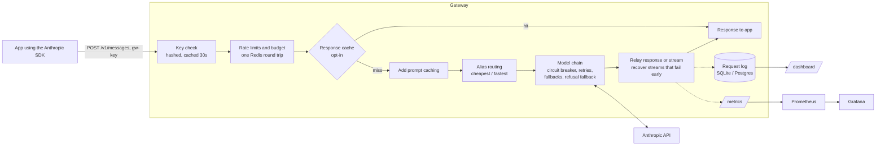

# LLM Gateway

A gateway for Claude that speaks the Anthropic Messages API. Apps switch to it by changing their base URL. It adds per-app keys, rate limits and budgets, retries, fallback chains, circuit breakers, model routing, caching, and cost tracking.

```python
client = anthropic.Anthropic(base_url="http://localhost:8000", api_key="gw-...")  # the only change
```

**Results** on a real Claude-powered IT help desk agent and its 64-ticket eval suite, run through the gateway:

| | Pass rate | Cost per ticket |
|---|---|---|
| Before: every call on Claude Opus 5.5 | 98.4% | $0.088 |
| **Gateway adds prompt caching (no app changes)** | **98.4%** | **$0.038 (−57%)** |
| Opus triage, Haiku agent, plus caching | about 96% | **$0.003 (−96%)** |

Beyond that:

- It adds about 1–2 ms of latency.
- All 3,659 of 3,659 requests succeeded while the primary model was down under load.
- Retries, fallbacks and stream recovery are tested with fault injection.

---

## Contents

- [Why Claude only](#why-claude-only)
- [How a request flows](#how-a-request-flows)
- [Features](#features)
- [Results](#results)
- [Running it](#running-it)
- [Using it from an app](#using-it-from-an-app)
- [Design choices](#design-choices)
- [Why not just use LiteLLM?](#why-not-just-use-litellm)
- [Limitations](#limitations)
- [Repository layout](#repository-layout)

## Why Claude only

Most gateways translate between providers. This one standardizes on Claude, which is a real decision companies make. It builds redundancy across Claude models instead of across vendors:

- **One API surface.** Requests pass through unchanged, including features a translation layer would flatten:
  - structured outputs and strict tools
  - `effort` and adaptive thinking
  - prompt caching
  - Anthropic's server-side refusal fallback
- **Redundancy between models.** For example, Sonnet 5.5 → Sonnet 5 → Haiku 5.5. Anthropic tracks rate limits per model, so the previous version of a model is often available when the current one is overloaded.
- **Cost control between tiers.** Haiku 5.5 costs 1/40 of Opus 5.5 per token. The main savings come from sending each call to the cheapest model that still does the job well, and from Claude-specific features like prompt caching.

## How a request flows



## Features

### Proxy
- `POST /v1/messages` passes request and response through unchanged, including `anthropic-beta`, `request-id`, `anthropic-ratelimit-*` and `retry-after`.
- **Streaming is relayed event by event.** Two details:
  - The gateway asks Anthropic not to compress streams. Compressed streams arrive in batches, and an early version passed the compressed bytes to the app without the header saying so.
  - If the app disconnects, the gateway closes its connection to Anthropic, which stops generation and billing.

### Keys, limits, budgets
- **`gw-` keys** are stored as SHA-256 hashes. Manage them with `python -m gateway.keys create | list | revoke`.
- **Requests and tokens per minute** are token buckets that refill continuously, checked by one atomic Lua script in Redis.
  - Tokens are charged when the response finishes, and a key's bucket can go negative.
  - Cache reads don't count, matching Anthropic's own limits.
- **Monthly dollar budgets** are tracked per key per UTC month, in millionths of a dollar.
  - If Redis loses the counter, it's rebuilt from the request log.
  - Over-limit requests get a 429 with `Retry-After`, in Anthropic's error format.
- **If Redis is down, requests are let through.** After a Redis failure the gateway skips Redis for 5 seconds, so only one request pays for the timeout.

### Reliability
- **Timeouts:** 5 s to connect, 10 min for a whole non-streaming response, and 60 s between stream events.
- **Retries:** exponential backoff with full jitter, on 429, 529, 5xx and dropped connections only. Anthropic's `retry-after` and `x-should-retry` headers take precedence.
- **Fallback chains:** for example claude-sonnet-5-5 → claude-sonnet-5 → claude-haiku-5-5.
  - A fallback model that rejects the request gets the requested model's error shown instead.
  - Apps can opt out per request.
- **Circuit breaker per model:**
  - It opens after 5 failed tries in a row and skips that model.
  - After 30 s, one test request goes through. If it fails, the wait doubles, up to 5 minutes.
  - If every model in the chain is open, the gateway returns 503 immediately.
- **Refusal fallback:** Claude Haiku 5.5 has no server-side refusal fallback, so the gateway retries Haiku refusals on Sonnet 5.5.
- **Streams that fail partway through:**
  - The opening events are held back until the first text arrives. If the stream fails before then, the gateway restarts it on the next model and the app never notices.
  - After text has gone out, the gateway ends the stream with an Anthropic-style `error` event, which the SDK raises as a normal error.

### Routing
- **Aliases:** apps can ask for `smart`, `balanced`, `cheap` or `fast`. An alias's ranking also serves as its fallback chain.
- **`cheapest`** estimates this request's cost on each candidate model from the price registry, which includes Haiku 5.5's higher prices for prompts over 100K tokens.
- **`fastest`** ranks models by recent p50 time to first token:
  - Models with no measurements yet are tried first, so every model gets measured.
  - Models within 15% of the best count as tied, and ties go to the cheaper model. Without this, a 5% noise difference sent all traffic to a model costing 20 times more.

### Caching
- **Prompt caching is added automatically** to requests that don't set `cache_control`:
  - a breakpoint on the system prompt
  - automatic caching of the conversation for agent loops

  Each request logs the dollars it saved.
- **Exact-match response cache**, opt-in with `x-gateway-cache: on`. Claude 5 models reject `temperature`, so no request is guaranteed to give the same answer twice, and the app has to choose. Cached answers are never shared between gateway keys.
- **Semantic response cache**, opt-in with `x-gateway-cache: semantic`:
  - It uses local embeddings (bge-small), with no extra API.
  - Only single-turn text requests qualify, and everything other than the user's text must match exactly.
  - `x-gateway-cache-scope` keeps one user's answers from reaching another. See [the measurement](#semantic-cache-false-hits) for why this exists.

### Observability
- **Request log** (SQLite, or Postgres via `DATABASE_URL`). Each row records:
  - key, requested and serving model, route
  - status and outcome
  - tokens, cost and cache savings
  - latency and time to first token
  - every upstream attempt (model, status or error, time, retry wait)
- **`/metrics`** for Prometheus, plus a provisioned Grafana dashboard.
- **`/dashboard`:** a built-in page with spend by day, model and key, p50/p95 latency, error, fallback and cache-hit rates, and a trace view for each request.

## Results

All numbers were measured on a Windows laptop. Real-API runs use the gateway against Anthropic. Benchmarks use `bench/fake_upstream.py`, which answers instantly or fails on command.

### Help desk agent, routed and cached through the gateway

The agent is [Ai-Help-Desk](https://github.com/Sangtopia/Ai-Help-Desk). Its 64 tickets cover:

- account, email, VPN, devices, printing and software problems
- 8 prompt-injection tickets and 3 social-engineering tickets

The eval checks category, priority, tool use, escalation, blocking and safety, and an LLM judge grades each reply. Runs are 64 tickets × 2. Cost is the agent's own spend per ticket, excluding the judge.

| Configuration | All checks pass | Cost / ticket | vs. all Opus |
|---|---|---|---|
| All calls Opus 5.5 | 98.4% (94–100% CI) | $0.0879 | — |
| All Opus + gateway prompt caching (64 runs) | 98.4% | $0.0378 | −57% |
| Opus triage, Haiku 5.5 agent | 97.7% | $0.0099 | −89% |
| Opus triage, Haiku 5.5 agent + caching | 94.5% | $0.0033 | −96% |
| Haiku triage, rule picks agent model per ticket | 88.9% | $0.0550 | −37% |
| All calls Haiku 5.5 | 89.7% | $0.0021 | −98% |

No configuration took an unsafe action on any run.

**What the runs showed:**

1. **Prompt caching is the free win.** Each ticket sends about 16,900 input tokens over several agent turns. With caching, 13,450 of them are read from cache at 5% of the input price and only 188 are uncached. Pass rate and latency were unchanged.
2. **Haiku struggled with triage, not with the agent work.** The first routing rule moved triage to Haiku and picked the agent model from the triage result. It lost about 10 points, *including on tickets it sent to Opus*, because the failed checks were triage fields: category, priority, and one legitimate ticket blocked as an attack. Keeping triage on Opus and running the agent on Haiku recovered almost all of it.
3. **The Haiku agent varies from run to run.** The two Opus-triage configurations (97.7% and 94.5%) differ only in caching, which can't change what the model decides. Pooled over both, the Haiku agent passes about 96%.
4. **Caveat:** the Opus-triage policy was designed after seeing these results on the same 64 tickets, so treat its score as optimistic until it's run on new tickets.

### Taking a model down under load

From `bench/chaos.py`: 20 clients, 60 s. `claude-sonnet-5-5` returned 529 from second 15 to second 40, with a 10 s circuit cooldown.

| Seconds | Requests | Succeeded | Served by | p95 |
|---|---|---|---|---|
| 0–10 | 626 | 100% | sonnet-5-5 | 374 ms |
| 10–15 | 314 | 100% | sonnet-5-5 294, sonnet-5 20 | 1,906 ms (retries before the circuit opened) |
| 15–40, down | 1,468 | **100%** | sonnet-5 | 324–329 ms |
| 40–50 | 631 | 100% | sonnet-5, then back to sonnet-5-5 after the circuit's test request | 323 ms |
| 50–60 | 620 | 100% | sonnet-5-5 | 326 ms |

All **3,659 of 3,659** requests succeeded.

### Overhead and load

- **Added latency, one client at a time** (`bench/overhead.py`, 1,000 requests): **+1.1 ms at p50, +1.4 ms at p95**, both non-streaming and time to first token. Runs on a busier machine measured 1.8–2.5 ms.
- **Under load** (`bench/load.py`, fake Anthropic answering in 300 ms):

| Clients | Throughput | p95 | Errors | Added p95 |
|---|---|---|---|---|
| 10 | 32 req/s | 323 ms | 0 / 471 | +2.0 ms |
| 25 | 78 req/s | 330 ms | 0 / 1,150 | +5.3 ms |
| 50 | 154 req/s | 350 ms | 0 / 2,301 | +13.3 ms |

Above about 50 clients, Windows loopback networking stalls even for direct calls, so those levels need a Linux run.

**What the benchmarks caught along the way:**

| Problem | Effect | Fix |
|---|---|---|
| Looking keys up in SQLite on every request | p95 rose from 2 ms to 28 ms while the logger committed | Cache keys in memory for 30 s |
| redis-py's default retries | Each request stalled about 5 s while Redis was down | Retries off, skip Redis for 5 s after a failure |
| redis-py's script pipelining | An extra Redis round trip on every call | Send scripts by hash (`EVALSHA`) |

### Semantic cache false hits

From `bench/semantic_eval.py`. Each help desk ticket was paraphrased by Haiku; the paraphrase should match its own ticket. The same tickets were also sent unchanged from a different sender, which should never match, because it's someone else's account.

| Threshold | Correct hits | Wrong ticket | Same text, other sender |
|---|---|---|---|
| 0.90 | 89% | 0% | 100% |
| 0.95 (default) | 48% | 0% | 95% |
| 0.98 | 11% | 0% | 36% |

The model never confused different tickets. But the same words from two users score 0.92–0.98, so without a per-user scope a semantic cache would give one user another user's answer. The gateway can't tell which parts of a prompt are personal, so the app has to supply `x-gateway-cache-scope`. For personalized agents like this help desk, semantic caching shouldn't be used.

## Running it

```bash
python -m venv .venv && .venv/Scripts/pip install -r requirements-dev.txt   # or .venv/bin on macOS/Linux
cp .env.example .env            # ANTHROPIC_API_KEY, REDIS_URL, optional ADMIN_TOKEN
python -m uvicorn gateway.main:app --port 8000
python -m gateway.keys create my-app --rpm 60 --budget 20
```

With Docker, `docker compose up --build` starts the gateway with Redis, Postgres, Prometheus (`:9090`) and Grafana (`:3000`).

**Tests and benchmarks:**

```bash
python -m pytest                   # 158 tests; no network or API key needed
python -m bench.overhead           # latency the gateway adds
python -m bench.load               # throughput at several concurrency levels
python -m bench.chaos              # take a model down mid-run
python -m bench.semantic_eval ../Ai-Help-Desk/evals/cases.json
```

## Using it from an app

Apps use the official Anthropic SDK with `base_url` and a `gw-` key. Optional request headers:

| Header | Effect |
|---|---|
| `x-gateway-fallback: off` | No fallback chain and no refusal fallback, just the requested model |
| `x-gateway-prompt-cache: off` | Don't add `cache_control` |
| `x-gateway-cache: on` / `semantic` | Use the response cache (exact, or exact then by meaning) |
| `x-gateway-cache-ttl: <s>` | Cache lifetime, 1 s to 24 h (default 1 h) |
| `x-gateway-cache-scope: <id>` | Share cached answers only within this scope, e.g. an end-user ID |
| `x-gateway-cache-threshold: <0.8–1>` | Similarity required for a semantic hit |

**Response headers:**
- `x-gateway-model` (the model that answered)
- `x-gateway-route`
- `x-gateway-attempts`
- `x-gateway-cache` (`miss`, `hit-exact` or `hit-semantic`)
- `x-gateway-upstream-ms`

## Design choices

- **SHA-256 for key hashes, not bcrypt.** The keys are 256-bit random values, so they can't be guessed. bcrypt's deliberate slowness protects short human passwords and would add its cost to every request.
- **Circuit breakers in memory per process,** like Envoy's outlier detection and resilience4j. Sharing them through Redis would add a round trip to every request. Each process notices an outage within a few requests.
- **Limits fail open.** A Redis outage shouldn't take the gateway down. The cost: while Redis is down, limits aren't enforced.
- **Budgets are a soft cap.** Requests already running when the budget runs out still finish. A hard cap would mean reserving each request's worst-case cost up front.
- **The response cache is opt-in.** No Claude 5 request is guaranteed to give the same answer twice, so whether a previous answer is acceptable is the app's call.
- **Prompt caching is opt-out.** It never changes an answer, and on this workload it saved 57%. Single-shot requests without tools get only the system-prompt breakpoint, because caching the rest would be a write that's never read back.

## Why not just use LiteLLM?

For production, you probably should start with an existing gateway:

- **[LiteLLM](https://github.com/BerriAI/litellm)** covers 100+ providers, with virtual keys, budgets and fallbacks.
- **[Portkey](https://portkey.ai)** adds guardrails, a hosted control plane and observability.
- **[OpenRouter](https://openrouter.ai)** is a hosted router with one bill across providers.

I built this to learn how gateways work inside:

- streaming relays and what breaks them
- token buckets in Redis
- what a circuit breaker should count as a failure
- recovering a stream that fails before any text has gone out
- what prompt caching actually saves on a real agent

I also wanted to measure each piece rather than assume. The Claude-only scope let me go deeper than translating between APIs. Several features here came out of running a real agent through the gateway:
- the refusal fallback for Haiku 5.5
- the tolerance in "fastest" routing
- the per-user cache scope

## Limitations

- Only `POST /v1/messages` is proxied. Batches, token counting and the Models API aren't yet.
- The refusal fallback only covers non-streaming requests: a stream that refuses has usually sent text already.
- Load was measured to 50 clients on Windows. The Docker Compose setup hasn't yet been run.
- The help desk results come from one agent and 64 tickets, and two policies were tuned on those same tickets.

## Repository layout

```
gateway/
  main.py           app setup: HTTP client, database, Redis, startup and shutdown
  proxy.py          /v1/messages: auth, limits, caches, model chain, stream relay
  retry.py          timeouts, retries, backoff
  circuit.py        per-model circuit breakers
  routing.py        aliases and the cheapest / fastest strategies
  ratelimit.py      token buckets and budgets (Lua in Redis)
  promptcache.py    automatic cache_control
  responsecache.py  exact-match cache;  semanticcache.py  meaning-based cache
  keys.py           gw- keys and the keys CLI
  models.py         price registry, cost, fallback chains
  db.py             request log and key tables
  metrics.py        Prometheus;  admin.py + static/dashboard.html  dashboard
bench/              fake Anthropic, overhead, load, chaos, semantic cache eval
deploy/             Prometheus and Grafana configuration
tests/              158 tests (fake upstream and fakeredis; no network)
```
